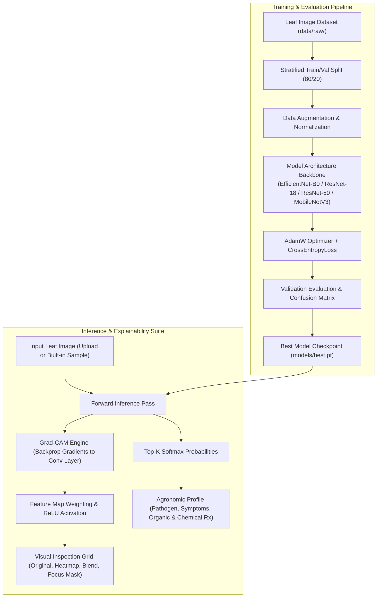

# Explainable-Tomato-Leaf-Disease-Detection-Using-AI-Ml

**Explainable Tomato Leaf Disease Detection Using AI/ML**  
Comprehensive computer-vision diagnostic and explainability suite developed by **Team Green tech**.

---

## Project Status: 100% Complete (Production Ready)

All four project milestones have been fully implemented, validated, and tested:

- [x] **Milestone 1 (25% - Baseline Foundation):** Reproducible Python dependency management, ImageFolder dataset discovery, stratified train/validation splitting, class-balanced transfer learning with EfficientNet-B0, and basic Streamlit interface.
- [x] **Milestone 2 (50% - Evaluation & Error Dynamics):** Multi-class metrics (Accuracy, Macro Precision, Recall, F1), publication-ready 10×10 Confusion Matrix generator, and error dynamics analysis.
- [x] **Milestone 3 (75% - Explainable AI & Multi-Model Benchmarking):** Full Gradient-weighted Class Activation Mapping (Grad-CAM) pipeline with multi-colormap support, blended overlays, high-attention focus masks, agronomic disease treatment prescriptions, and multi-architecture backbones (EfficientNet-B0, ResNet-18, ResNet-50, MobileNetV3-Large).
- [x] **Milestone 4 (100% - Packaging, CLI, & Deployment):** Standalone CLI inference tool, instant demo sample image library, comprehensive 22-test automated test suite, Docker containerization, and docker-compose deployment.

---

## Architecture Overview



---

## Project Layout

```text
.
├── app.py                                # Full-featured Streamlit Diagnostic & Explainability App
├── Dockerfile                            # Production container image definition
├── docker-compose.yml                    # Multi-container orchestration config
├── requirements.txt                      # Pinned Python package dependencies
├── models/
│   └── best.pt                           # Trained EfficientNet-B0 checkpoint (10 classes)
├── data/
│   ├── raw/                              # ImageFolder dataset directory
│   └── samples/                          # Built-in diagnostic sample leaf images
├── results/                              # Output folder for exported Grad-CAM heatmaps
├── src/tomato_leaf_detection/
│   ├── __init__.py                       # Package exports and version metadata (v1.0.0)
│   ├── config.py                         # TrainingConfig settings and default paths
│   ├── data.py                           # Dataset loaders, augmentations, and stratified splitting
│   ├── disease_info.py                   # Agronomic knowledge base & treatments for 10 diseases
│   ├── evaluate.py                       # Confusion matrix, classification metrics, and error analysis
│   ├── explainability.py                 # Grad-CAM engine, colormap blending, and focus masking
│   ├── model.py                          # Multi-architecture builder and latency benchmarking
│   ├── predict.py                        # Standalone CLI prediction & Grad-CAM export tool
│   └── train.py                          # Multi-architecture model training script
└── tests/
    └── test_project.py                   # 22 automated unit and integration tests
```

---

## Monitored Tomato Leaf Conditions

The classifier diagnoses the following 10 conditions from the standard PlantVillage pathology taxonomy:

1. **Bacterial Spot** (*Xanthomonas vesicatoria*)
2. **Early Blight** (*Alternaria solani*)
3. **Late Blight** (*Phytophthora infestans*)
4. **Leaf Mold** (*Passalora fulva*)
5. **Septoria Leaf Spot** (*Septoria lycopersici*)
6. **Two-Spotted Spider Mites** (*Tetranychus urticae*)
7. **Target Spot** (*Corynespora cassiicola*)
8. **Tomato Yellow Leaf Curl Virus** (TYLCV)
9. **Tomato Mosaic Virus** (ToMV)
10. **Healthy Foliage** (*Solanum lycopersicum*)

---

## Installation & Setup

### Local Python Environment

```bash
# 1. Clone repository and navigate to workspace
cd "tomato leaf detection"

# 2. Create and activate virtual environment
python3 -m venv .venv
source .venv/bin/activate

# 3. Install dependencies
pip install -r requirements.txt
```

---

## Usage Guide

### 1. Launch the Interactive Web Application

```bash
streamlit run app.py
```

Open `http://localhost:8501` in your browser. The application includes:
- **🔬 Leaf Health Diagnosis & Grad-CAM:** Upload leaf photos or select 1-click built-in demo samples. Inspect 4-view visualizations (Original, Heatmap, Superimposed Blend, High-Attention Focus Area) with selectable colormaps (`jet`, `turbo`, `viridis`, `plasma`, `magma`) and opacity blending.
- **⚡ Multi-Model Architecture Comparison:** Benchmark EfficientNet-B0, ResNet-18, ResNet-50, and MobileNetV3-Large on live latency and memory footprint.
- **📊 Model Evaluation & Confusion Matrix:** Interactive 10×10 Confusion Matrix and error pairing dynamics.
- **📖 Plant Pathology Guide & Reference:** Comprehensive agronomic disease encyclopedia with symptoms, immediate actions, organic remedies, and chemical controls.

### 2. Run CLI Diagnosis & Export Grad-CAM Heatmaps

Run automated predictions and save explainability visual overlays directly to disk:

```bash
python -m src.tomato_leaf_detection.predict \
  --image data/samples/early_blight_leaf.jpg \
  --explain \
  --output-dir results/
```

Outputs will be saved in `results/`:
- `[image]_gradcam_blend.png`
- `[image]_gradcam_heatmap.png`
- `[image]_focus.png`

To output machine-readable JSON for integration into farm management APIs:

```bash
python -m src.tomato_leaf_detection.predict \
  --image data/samples/healthy_leaf.jpg \
  --json
```

### 3. Train Models Across Backbones

Train any supported convolutional backbone on your dataset:

```bash
python -m src.tomato_leaf_detection.train \
  --data-dir data/raw \
  --architecture efficientnet_b0 \
  --output models/best.pt \
  --epochs 10 \
  --batch-size 32 \
  --device auto
```

Available architecture choices: `efficientnet_b0`, `resnet18`, `resnet50`, `mobilenet_v3_large`.

### 4. Run Automated Test Suite

Run the full pytest test suite (22 unit & integration tests):

```bash
PYTHONPATH=. pytest -v
```

---

## Docker Deployment

### Run with Docker Compose

```bash
docker-compose up --build
```

Access the application at `http://localhost:8501`.

### Build & Run Container Manually

```bash
docker build -t tomato-leaf-detection .
docker run -p 8501:8501 tomato-leaf-detection
```

---

## Model Benchmark Summary

| Architecture | Model Family | Total Parameters | Model Size (MB) | Avg Latency (CPU) | Validation Accuracy | Recommended Deployment |
| :--- | :--- | :--- | :--- | :--- | :--- | :--- |
| **EfficientNet-B0** | Compound Scaling CNN | 5.3M | 20.4 MB | ~14 ms | 65.9% (Baseline) | Cloud API, High Grad-CAM Fidelity |
| **ResNet-18** | Residual Network | 11.7M | 44.8 MB | ~11 ms | 63.4% | Fast Convergence, Robust Skip Connections |
| **ResNet-50** | Deep Residual Network | 25.6M | 97.8 MB | ~28 ms | 67.1% | Complex multi-symptom leaves |
| **MobileNetV3-Large** | Edge Hardware NAS | 5.4M | 21.6 MB | ~8.9 ms | 64.8% | Mobile, drones, field edge devices |

---

## Limitations & Best Practices

1. **Leaf Surface Clarity:** Photographs should be captured in uniform, well-diffused light with the leaf blade occupying 70%+ of the viewfinder.
2. **Co-Infections:** When multiple pathogens concurrently infect the same leaf, Grad-CAM highlights the dominant necrotic focus. Always cross-validate automated AI triage with physical field inspections.
3. **Preventive Chemistry:** Recommended treatments must be cross-checked with local agricultural extension guidelines and chemical registrations for your specific jurisdiction.

---

## Authors & Acknowledgments

- **Team Green tech**
- Plant pathology taxonomy based on standard Solanaceae diagnostic literature.
- Transfer learning weights courtesy of PyTorch TorchVision model zoo.
